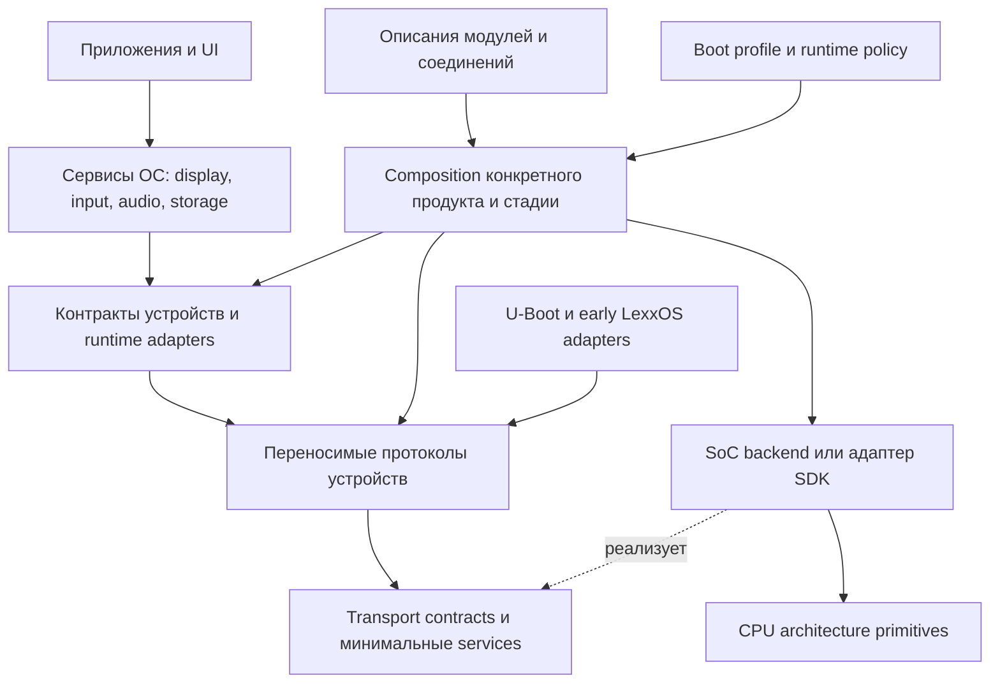

# Следующая большая цель: переносимые драйверы, составные платы и единая загрузка

Обновлено 29 октября 2026. Статус: **частичная реализация HW-2/HW-3/HW-4/HW-7; приёмка открыта**.
Документ основан на текущем коде ветки Lyra. Активные этапы и их статус ведутся
в [корневом roadmap](../roadmap.md#следующая-большая-цель-драйверы-платы-и-загрузочная-цепочка).
Это развитие [архитектурного плана](architecture-roadmap.md), а не замена уже
работающих Runtime, VFS, DeviceManager и контрактов устройств.

Актуальные границы и остаток работ: [состояние миграции](hardware-migration-first-step.md).
Выполненные изменения: [черновик release notes 0.1.1](release-0.1.1.md).

Последующее развитие IRQ/GIC, PL330 DMA, вытесняющей многозадачности,
MMU и SMP ведётся по [отдельному плану KRN-*](armv7a-irq-dma-kernel-roadmap.md).
HW-1/HW-MEM/HW-3/HW-6/HW-7 закладывают необходимые контракты и ownership,
но сами по себе не включают перенос планировщика или SMP.

## 1. Результат, к которому идём

Один драйвер модели устройства должен работать на разных процессорах, SoC,
платах и стадиях загрузки через явно переданные зависимости. Например, протокол
ILI9488 не должен знать RK3506, Pico SDK, номер SPI0, распиновку PicoCalc,
планировщик LexxOS или U-Boot. Но он вправе знать команды и ограничения ILI9488:
«независимый от аппаратной платформы» не означает «независимый от модели устройства».

Описание устройства должно собираться из вычислительной платы, несущей платы,
соединений и профиля использования. PicoCalc + Lyra, PicoCalc + Pico и Lyra без
PicoCalc — разные композиции, а не три скопированных аппаратных порта.

Полноценное устройство на всех **управляемых** стадиях означает заранее
определённые возможности, понятное состояние загрузки, доступный путь диагностики
и корректную передачу ресурсов следующей стадии. Это не требует запускать
полный runtime, DMA-аудио, VFS и приложения внутри SPL.

Основной критерий: одна вертикальная цепочка **плата → транспорт → протокол дисплея/контроллера → U-Boot → early
LexxOS → runtime**
проверена целиком; общий драйвер дополнительно работает на втором backend.
Сборка без железа и аппаратная приёмка фиксируются раздельно.

## 2. Исходная карта связанности

Таблица фиксирует исходную точку проектирования 26 октября, а не текущий backlog.
Актуальные границы — в [состоянии миграции](hardware-migration-first-step.md);
описания текущих providers и core нельзя выводить из этой исторической карты.

| Сейчас                                                                                       | Наблюдаемая связанность                                                                                        | Планируемое изменение                                                                                   |
|----------------------------------------------------------------------------------------------|----------------------------------------------------------------------------------------------------------------|---------------------------------------------------------------------------------------------------------|
| [SpiBus](../src/lexxos/devices/bus/spi_bus.h), [I2cBus](../src/lexxos/devices/bus/i2c_bus.h) | Принимают pin-структуры из `platform/board.h`, имеют глобальные accessor-ы; SPI смешивает controller, CS и DMA | Независимые transport contracts, отдельные controller и device endpoint; wiring передаёт composition    |
| [BoardDescriptor](../src/lexxos/platform/board.h)                                            | Identity, wiring, периферийные модели, storage и runtime policy в одной растущей структуре                     | Identity + типизированные component declarations + connections + отдельный product policy               |
| [platform_rk3506.cpp](../src/lexxos/platform/rockchip/rk3506/platform_rk3506.cpp)            | SoC adapter, MMIO и PicoCalc/Lyra descriptor в одном файле                                                     | SoC backend, описание Lyra, описание PicoCalc и binding связки                                          |
| [RK3506 provider](../src/lexxos/composition/detail/rk3506_device_providers.cpp)              | Знает конкретную клавиатуру/панель, использует static instances и `debugI2cBus()`                              | Product composition выбирает providers и владеет экземплярами; SoC сам не выбирает периферию            |
| [Ili9488Display](../src/lexxos/devices/display/ili9488_display.cpp)                          | Команды панели вместе с Pico SDK/RK3506 branches, DMA и размерами рабочих буферов                              | Общее panel core, transport adapters, отдельно framebuffer/render service и memory policy               |
| [picocalc_splash.c](../ports/uboot/picocalc_lyra/picocalc_splash.c)                          | MMIO, pinmux, wiring, panel init и рисунок в одном U-Boot файле                                                | Backend U-Boot + общий panel core + общие board data + boot presentation                                |
| PicoCalc keyboard / southbridge                                                              | Уже есть общий controller/service, но раннее окружение не отделено от runtime                                  | Общее ядро протокола STM32, один владелец FIFO, stage adapters и runtime facade                         |
| RK3506 `picosd_*`, общий `storage/sd_spi_*`                                                  | Параллельные SD SPI пути; SoC, protocol, diagnostics и slot policy ещё частично связаны                        | Один проверенный SD SPI protocol core, отдельные SPI/SDMMC backends, block adapters и mount policy      |
| [ESP-IDF audio](../src/lexxos/devices/audio/espidf_es8311_audio_device.h)                    | Codec, I2S и lifecycle в одном классе                                                                          | Codec control через I2C, поток PCM через I2S transport, audio service отдельно                          |
| `platform/rockchip/rk3506/`                                                                  | ARM startup/context, GIC, board и storage inspection соседствуют                                               | CPU architecture, SoC, boot adapter, filesystem inspection и board composition разделить по зависимости |
| [ports/lyra](../ports/lyra/README.md)                                                        | Полный образ собирается с закреплённым бинарным DDR/SPL и ресурсами                                            | Сохранить рабочий профиль; новые стадии и их manifests вводить отдельно, без скрытой замены loader      |

Предыдущая [ревизия RK3506](boards/picocalc_lyra_m.md#архитектура-порта) остаётся исходным
перечнем storage/runtime ограничений. Перемещение файлов само по себе не закрывает
ни один пункт этой миграции.

## 3. Целевые уровни и допустимые зависимости



| Уровень                      | Принадлежит ему                                                                                                              | Не принадлежит ему                                                   |
|------------------------------|------------------------------------------------------------------------------------------------------------------------------|----------------------------------------------------------------------|
| CPU architecture             | ABI, exceptions, context switch, barriers, cache/MMU primitives, системные регистры; ARM generic timer primitive при наличии | Номера GPIO, PLL конкретного SoC, раскладка клавиатуры               |
| SoC / SDK backend            | MMIO, clocks/resets, pinctrl, IRQ-controller integration, UART/SPI/I2C/I2S/SDMMC/DMA, controller limits                      | Выбор панели/клавиатуры продукта, `/mnt/sd`, boot UI                 |
| Board/module description     | Компоненты, ревизия, питание, connector pin map, электрические ограничения                                                   | MMIO-последовательности, создание объектов драйверов, очереди задач  |
| Product/assembly composition | Соединение модулей, выбор экземпляров, memory/stage profiles, ownership и policy                                             | Алгоритмы протоколов устройств                                       |
| Device protocol core         | Команды чипа, состояние протокола, проверка ответов, обязательные задержки, восстановление                                   | SDK headers, platform macros, VFS, scheduler, глобальный поиск платы |
| Stage adapter                | Привязка core к API U-Boot, раннему окружению или DeviceManager LexxOS                                                       | Вторая копия протокола чипа и pin map                                |
| OS services                  | Keyboard layout/repeat, console rendering, mixer, automount, power policy                                                    | Доступ к MMIO и выбор SPI по имени платы                             |

GIC и ARM generic timer не объявлять одинаково «SoC» или «CPU» по расположению
старого файла: выделить архитектурные механизмы, а адреса, interrupt routing,
security ownership и board-specific choices оставить в platform integration.
FreeRTOS/cooperative scheduler — адаптер исполнения, а не разновидность CPU.

Не создавать универсальный HAL с сотнями необязательных методов. Использовать
маленькие контракты по реальным потребителям; расширение обосновывается двумя
backend или конкретным stage use case. Высокоуровневые сервисы сохраняют
существующие `DisplayDevice`, `InputDevice`, `BlockDevice`, `AudioDevice`, где
их семантика подходит. Новые интерфейсы не должны дублировать их без причины.

## 4. Описание платы и связки плат

Предлагаемая модель: `ArchitectureId`, `SocId`, `ModuleId/Revision`, `Connector`,
`Component`, `Connection`, `ProductProfile`, `StageProfile`. Названия предварительные.

Для PicoCalc + Lyra разделить:

1. **RK3506G2**: доступные controllers, clock/reset domains, interrupt IDs,
   pinmux alternatives, memory map и ограничения DMA.
2. **Lyra нужной ревизии**: SoC/package, DDR, boot SDMMC, выведенные сигналы,
   питание и connector mapping. Не подразумевать PicoCalc как обязательную периферию.
3. **PicoCalc нужной ревизии**: ILI9488, STM32 southbridge, съёмный SD-слот,
   питание/подсветка и сигналы разъёма. Адрес STM32 и тип панели принадлежат модулю.
4. **Binding Lyra ↔ PicoCalc**: сигналы разъёма сопоставляются с конкретными GPIO,
   pinmux и controllers; здесь появляются SPI0 LCD, SPI1 SD, I2C2 southbridge.
5. **Product policy**: системный `sd0` read-only без automount, съёмный `sd1`,
   `/mnt/sd`, выбранная консоль, boot input window, яркость, feature/memory profile.

PicoCalc + Pico переиспользует описание периферии, но имеет другой binding.
Lyra standalone не регистрирует фиктивный STM32. Factory/JCS — версия протокола
контроллера с явными capabilities, а не новый SoC. Ревизии плат и прошивок
фиксировать отдельно; неизвестный protocol не угадывать посредством опасных команд.

**Формат первого этапа:** типизированные constexpr declarations для LexxOS;
без runtime JSON/YAML parser. Если нужен общий источник для C, C++ и DTS,
ввести небольшой build-time generator и versioned schema. Выбор формата
зафиксировать ADR до реализации генератора. Данные устройств и их схемы
разнести по модулям, не переносить гигантский `BoardDescriptor` в гигантский JSON.

Валидатор обязан выявлять: неизвестный endpoint, конфликт CS/pinmux/GPIO,
повторный I2C address на одной физической шине, несовместимый voltage/polarity,
несуществующий clock/reset, превышение частоты, циклы зависимостей питания,
несовместимые ревизии и два владельца одного controller. Разделяемые линии
и альтернативные pin states разрешаются явно. Проверка declarations не заменяет
схему платы и измерение напряжений/таймингов.

Одна физическая I2C2, доступная под `debug` и `system`, должна иметь одного
владельца и один lock. Число GPIO не уникально между SoC GPIO, RM_IO и внешним
expander: ввести типизированный domain/controller/pin вместо голого `int`.

Генерация DTS не означает немедленной замены vendor DTB. Сначала генерировать
только проверенные fragments и отчёт расхождений, затем сверять resolved tree.
Память, reserved-memory, clocks и узлы, которые читает U-Boot, сохранять до
отдельной аппаратной приёмки; подписи/хеши ресурсов обновлять упаковщиком.

## 5. Контракты транспорта и исполнения

| Контракт                  | Обязательная семантика перед миграцией                                                                                                                                            |
|---------------------------|-----------------------------------------------------------------------------------------------------------------------------------------------------------------------------------|
| SPI controller + endpoint | Mode, bit order, word size, max/actual Hz, CS polarity/ownership, удержание CS на нескольких сегментах, DC transitions, duplex, lock на всю транзакцию                            |
| I2C controller + endpoint | 7/10-bit addressing по capability, combined write/read с repeated start, STOP, NACK/error position, deadline, recovery и ownership общей шины                                     |
| UART                      | Byte stream, baud/format, RX/TX buffering, flush/drain, overflow, polling и optional IRQ/DMA; console routing отдельно                                                            |
| Поток I2S/PCM             | Ведущий/ведомый, MCLK/BCLK/LRCLK, формат и порядок байтов, слоты/каналы, фактическая частота, периодические буферы, недозаполнение/переполнение, завершение/остановка/приглушение |
| GPIO/pinctrl              | Активный уровень, input/output/open-drain, pulls, safe initial state, отдельные ownership и mux states                                                                            |
| Clock/reset/power         | Кто разрешает изменение, reference ownership, зависимости, reset только принадлежащего устройства, безопасный teardown                                                            |
| Time/wait                 | Monotonic deadline, rollover, единицы времени, bounded polling без scheduler; sleep/yield разрешаются только stage adapter                                                        |
| Block I/O                 | Sector size, LBA bounds, read/write policy, media generation, sync/flush, ошибки и invalidation при извлечении                                                                    |
| Optional async/DMA        | Lifetime/alignment буфера, cache clean/invalidate, cancellation/completion, контекст callback, запрет повторного использования до завершения                                      |

I2S не подменять SPI: поток, тактирование и непрерывное обслуживание буфера имеют
другую семантику. Codec control через I2C — отдельный драйвер от PCM transport.
Одна и та же PCM service может работать поверх I2S или PWM backend.

Определить типизированный результат: unsupported, not-ready, busy, timeout,
NACK/I/O, partial transfer, removed, invalid argument; число переданных данных
и состояние endpoint после отказа. `bool` wrappers оставить на время миграции.
Синхронный fallback для async должен честно объявлять свои свойства; ранняя
стадия не должна «поддерживать DMA» только потому, что метод вернул success.

Владельцем controllers, buffers и драйверов является composition экземпляра.
До scheduler — bounded polling, после — task-safe arbitration. ISR не вызывает
VFS, не ждёт mutex и не выполняет recovery. Определить порядок lock-ов, например
service → endpoint transaction → controller; callbacks не входят обратно в
захваченный service. Ограничения SMP/preemption документировать даже при CPU0.

`initialize`, `probe`, `start`, `quiesce`, `stop`, `recover`, `status` должны
иметь различимые последствия. Повторный вызов не должен случайно сбрасывать
панель, FIFO или общий clock domain. Optional device может стать unavailable
без остановки загрузки; required boot storage — отдельный fatal/recovery policy.

## 5.1. Единая конфигурация памяти и лимитов

Добавить базовую конфигурацию памяти в `config/memory/` (планируемый каталог)
и разрешать её на этапе сборки. Начальная точка — существующий
`src/lexxos/runtime/runtime_profile.h`, а не второй независимый RuntimeProfile.
Порядок наложения: **base → SoC/SDK memory capabilities → board/product →
boot/runtime stage → feature profile → явный пользовательский override**.
Физические ограничения не переопределяются: каждый слой проходит валидацию.

Pico/RP2040, Pico2/RP2350, семейства ESP32 и Lyra получают отдельные профили.
Больше RAM позволяет увеличить стеки, очереди и buffers, но значения выбираются
по реальной доступной памяти и измерениям, а не по имени семейства. ESP32 без PSRAM
и с PSRAM различаются; DDR Lyra нельзя считать целиком свободной из-за reserved
regions/OP-TEE/bootloader. До и после DDR действуют разные бюджеты.

В конфигурации задать:

- Размеры стеков **каждой** системной задачи, default/min/max stack программы,
  max concurrent tasks/processes и запас interrupt/exception stacks.
- Heap/arena budgets, лимиты `.lexx` VM и workspace программ, внутреннюю/внешнюю
  память, отдельные DMA-capable и cache-aligned pools; ISR/early allocations запрещать явно.
- Вместимость очередей, реестров устройств, shell/history, VFS/mount/cache,
  input/audio buffers, framebuffer/scanline и число DMA periods.
- Memory regions, reserved ranges, alignment и доступность для CPU/DMA/stages;
  явный fallback при отсутствии внешней памяти, без молчаливого перерасхода internal RAM.

Единицы публичной конфигурации — **байты** для стеков и памяти; adapter FreeRTOS
переводит их в native stack units с округлением и проверкой overflow. ESP-IDF и
обычный FreeRTOS могут иметь разные соглашения API — не переносить числа напрямую.
Динамический размер задачи не может превышать compile-time capacity её storage.

Генерировать один resolved memory profile, C/C++ headers и при необходимости
linker fragments; выводить происхождение каждого значения в build report и
manifest образа. Проверять сумму статических данных, heap, стеков, buffers и
reserved regions без двойного учёта вложенных pools. Несовместимые overrides
завершают configure ошибкой, а не скрыто обрезаются. Runtime diagnostics показывают
выбранный профиль, stack high-water marks и arena usage.

В HW-0 снять текущие фактические лимиты; HW-1 утверждает schema/precedence/units;
HW-2 связывает memory profile с продуктом; HW-3/HW-6 подключают ранние и runtime
allocators/stacks; HW-8 учитывает DMA/audio/display pools; HW-10 мигрирует текущие
разрозненные defines и CMake defaults. Первой миграцией сохранить существующие
значения. Увеличивать бюджеты ESP32/Lyra отдельными измеряемыми изменениями.
Тесты: resolution/override, отсутствие PSRAM, overflow, превышение региона,
две задачи с разными стеками, pre-DDR budget и сравнение map-файла с расчётом.

## 6. Переносимое ядро драйвера и адаптеры стадий

Для ранних общих протоколов выбрать **freestanding C-compatible ядро**:
явный context, caller-owned memory, callbacks транспорта/таймера, status codes,
без heap, STL, RTTI, exceptions, OS singleton и неявных static constructors.
C++ adapter предоставляет привычный интерфейс устройствам LexxOS; U-Boot
adapter использует доступные API его закреплённой версии. Не переносить весь
C++ DeviceManager или Runtime внутрь U-Boot.

Общими должны стать алгоритмы протокола и проверенные данные инициализации.
Controller MMIO код не обязан быть одним между U-Boot и LexxOS: сначала
переиспользовать штатные механизмы U-Boot, если они доступны в нужной фазе.
До relocation и после него API/память различаются; доступность Driver Model,
video/stdio/input и DT проверить в нашей версии, а не предполагать по новому upstream.
При отсутствии подходящего API допускается узкий polling adapter с явным владельцем.

Не все существующие C++ драйверы переписывать на C: C-core нужен тем частям,
которые действительно работают в нескольких boot environments. Host/runtime-only
services остаются C++. Для shared sources зафиксировать происхождение и условия
включения в U-Boot; не переносить vendor/GPL реализации в общую библиотеку
под другой лицензией. Копирование shared файлов в build tree автоматическое,
с хешами; ручные копии протокола в двух каталогах запрещены.

### Порядок устройств для первой вертикальной миграции

| Устройство        | Общее ядро                                                                       | Stage/runtime особенности                                                                                      |
|-------------------|----------------------------------------------------------------------------------|----------------------------------------------------------------------------------------------------------------|
| ILI9488           | Команды, init table, window/orientation, wire format, обязательные задержки      | Boot renderer минимален; runtime renderer и оптимизация DMA отдельны; RGB565 API не означает RGB565 на проводе |
| STM32 southbridge | Регистры/protocol factory и JCS, FIFO access, battery/backlight/power primitives | Один владелец destructive FIFO; layout/repeat и sleep policy — runtime; boot key consumption оговорено         |
| SD SPI            | CMD/data/CRC/state machine, limits/recovery                                      | Controller backend, block adapter и slot/mount policy разделены; сначала read-only boot operations             |
| UART console      | Переносимый stream adapter и routing policy                                      | Ранний polled panic output независим от logger/scheduler; UART0/UART1/SWD не перенастраивать неявно            |
| Audio             | Codec protocol отдельно от PCM transport                                         | Ранняя стадия по умолчанию mute/safe power; звук только после подтверждения clock/routing и budget             |
| Прочая периферия  | RTC, sensors, touch, GPIO expanders по тем же контрактам                         | Переносить по конкретному use case, не включать всё в обязательный SPL                                         |

Для southbridge нельзя одновременно иметь boot keyboard reader и независимый
battery reader, которые нарушают register/FIFO sequence. Boot adapter и runtime
adapter в разные моменты владеют одним протоколом; warm reset SoC не означает
reset STM32. Его питание, удерживаемые клавиши и очередь могут пережить перезапуск.

## 7. Возможности по стадиям загрузки

Это **целевая матрица**, а не описание текущей поддержки. Возможности включаются
только после проверки RAM, clock/pinmux, controller ownership и budget стадии.

| Стадия                                   | Console/status                             | Display/input/power                                                        | Storage/audio                                                   | Условие                                          |
|------------------------------------------|--------------------------------------------|----------------------------------------------------------------------------|-----------------------------------------------------------------|--------------------------------------------------|
| BootROM                                  | Только то, что предусмотрено ROM           | Свой драйвер внедрить нельзя                                               | Штатный boot source                                             | Исключение из обещания общего UI                 |
| Бинарный DDR init / нынешний SPL         | Сохранить доступную диагностику поставщика | Собственные callbacks сейчас не гарантированы                              | Только текущая загрузочная цепочка                              | Не патчить бинарник ради заставки                |
| Будущий управляемый SPL до DDR           | Минимальный UART, stage/error code         | GPIO safe states; LCD/input лишь если доказаны budget и доступность        | Boot media минимум; audio off                                   | SRAM/stack/ROM-format и recoverability проверены |
| SPL после DDR, если есть подходящий hook | UART и прогресс                            | Возможны splash + bounded keyboard/power polling                           | Load/verify следующего этапа; без automount                     | Отдельная сборка SPL, не изменение DDR blob      |
| U-Boot proper                            | UART + минимальный локальный статус/menu   | Display, southbridge keyboard, backlight, батарея; recovery выбор          | Boot reads, диагностический RO доступ; audio mute по умолчанию  | До/после relocation разделены                    |
| Early LexxOS до runtime                  | Ранняя console, stage/errors               | Принять panel state или безопасно переинициализировать; ограниченный input | Только необходимые boot операции; DMA пока выключен             | Нет зависимости от scheduler/VFS                 |
| LexxOS runtime                           | Shell/UI, logger                           | Полные display/input/power services                                        | Storage, hotplug, audio по capabilities                         | Владение передано сервисам ОС                    |
| Panic/recovery/shutdown                  | Независимый bounded UART path              | Последний статус, безопасная подсветка; input только если безопасен        | Завершить/остановить I/O, mute; никаких рискованных auto writes | Нельзя ждать упавший scheduler/lock бесконечно   |

«Сразу драйверы для U-Boot и ранней загрузки» означает, что их adapters входят
в первую вертикальную реализацию, а не откладываются до завершения всей ОС.
До доступного SPL hook честная граница общего UI — U-Boot proper. Расширение
в SPL — обязательный исследовательский этап с отдельным решением, а не обещание
редактируемости текущего бинарника. Отказ от переноса UI в SPL нужно явно
согласовать как ограничение цели; успешный U-Boot splash этого пункта не закрывает.

## 8. Передача управления и состояния

Разделить два механизма: стандартный ARM handoff bootloader → LexxOS и описание
состояния периферии. Не менять договорённость `bootm`/Linux-style entry только
ради нового драйверного API. Не использовать `go` как эквивалент загрузки.

Предложение: versioned `BootContext` в согласованной reserved-memory области,
ссылка через проверенный DT property или иной явно согласованный boot ABI.
Конкретный адрес и способ передачи выбираются после карты памяти — в план не
закладывается произвольный свободный адрес. Не конфликтовать с OP-TEE, FIT/DTB,
relocation U-Boot, стеком, decompression и kernel load/entry `0x02000000`.

Содержимое: magic/version/length/checksum, board/profile/schema IDs, boot reason,
stage/error codes, boot source, console route, capabilities, состояние панели
и её конфигурационный hash, backlight state, ownership flags. Framebuffer только
если существует: для SPI ILI9488 изображение может жить в GRAM самой панели,
и передавать фиктивный framebuffer pointer нельзя. Допускается компактный ring
ранних логов с фиксированными лимитами и физическими адресами.

Не передавать C++ объекты, function pointers, DMA descriptors или указатели на
уже освобождённую U-Boot память. Проверять bounds/версии/endian/alignment;
checksum обнаруживает повреждение, но не является аутентификацией. При неизвестной
версии, SWD reload, watchdog/warm reset или несовпадении профиля использовать
контролируемую полную инициализацию. Наличие magic не доказывает актуальность
состояния периферии: нужны boot-session marker и reset policy.

Перед jump: прекратить новые операции, завершить или отменить DMA с deadline,
освободить CS, очистить/замаскировать принадлежащие стадии IRQ, согласовать caches,
сохранить разрешённые clock/power states. Не сбрасывать чужие secure interrupts
и OP-TEE resources. Прямой переход polling → DMA разрешается только после
установки собственных IRQ, memory/cache policy и runtime ownership.

Бесшовный экран: один источник init parameters, отсутствие повторного hardware
reset при валидном handoff, сохранение GRAM, первая runtime перерисовка без
промежуточной очистки. Несовпадение параметров → ожидаемая повторная init,
а не попытка продолжить в неизвестном режиме. Boot key, использованный для menu,
не должен затем случайно выполнить shell-команду: определить drain/release policy,
сброс modifiers/repeat и обработку удерживаемой клавиши.

## 9. Предлагаемое размещение файлов

Схема предварительная; не создавать пустые каталоги и не переносить все файлы
одним механическим коммитом. Для каждой группы сначала менять зависимости,
затем расположение. Действующие пути и wrappers сохранять до миграции callers.

```text
src/lexxos/arch/armv7a/                  CPU mechanisms
src/lexxos/arch/cortex_m/                перенос по реальным SoC/profile
src/lexxos/hal/contracts/                маленькие transport/resource contracts
src/lexxos/hal/soc/rk3506/               MMIO, pinctrl, clocks, IRQ/DMA bindings
src/lexxos/hal/backends/{pico,espidf,stm32,host}/
src/lexxos/hardware/modules/             Lyra, PicoCalc, Pico и ревизии
src/lexxos/hardware/products/            bindings, policy и stage profiles
src/lexxos/drivers/core/                 shared freestanding protocols
src/lexxos/drivers/adapters/lexxos/      DeviceManager-facing adapters
src/lexxos/boot/                         BootContext, early services, stage state
src/lexxos/composition/                  lifecycle и ownership продуктов
ports/uboot/                            U-Boot adapters и integration patches
ports/lyra/                             состав образа, manifests, flash/update
ports/lyra/spl/                         только после принятого решения по SPL
third_party/rk3506-luckfox-lurra/        неизменные лицензированные prebuilts
```

`ports/lyra` остаётся портом загрузки/образа, а не вторым деревом общего ядра.
На host реализуются fake transports тех же contracts. Полный RISC-V port не
включён в этот milestone: модель должна его допускать без добавления фиктивной
«поддержки» и без требования третьей архитектуры для первого результата.

## 10. Последовательность этапов и выходные артефакты

Идентификаторы `HW-*` используются в roadmap. Оценка S/M/L — относительный объём (S: локальное изменение, M: несколько
адаптеров, L: несколько подсистем и
аппаратных итераций), не календарное обещание. Каждый этап разбивается на
reviewable изменения; интерфейсы, механический перенос и изменение поведения
разделять. Назначить ответственного и календарный бюджет после HW-0/HW-1.

| Этап                                 | Зависит от                                      | Что сделать / добавить / разделить                                                                                                                                     | Приёмка                                                                                                                                     | Объём                       |
|--------------------------------------|-------------------------------------------------|------------------------------------------------------------------------------------------------------------------------------------------------------------------------|---------------------------------------------------------------------------------------------------------------------------------------------|-----------------------------|
| HW-0. Baseline                       | —                                               | Зафиксировать manifests/хеши рабочего loader и образа, схемы и ревизии, UART cold/warm boot logs, карту ресурсов, время boot и размер секций; сохранить recovery-карту | Полная запись чистой SD и холодный запуск отдельно от update; документированы рабочий baseline и восстановление                             | M                           |
| HW-1. Контракты и решения            | HW-0                                            | ADR: слои, transport API, C/C++ boundary, module schema, ownership, memory/stage profiles, BootContext; инвентаризация callers и возможностей закреплённого U-Boot/SPL | Матрица current/planned/unsupported; для каждого API есть потребитель и negative scenario                                                   | M                           |
| HW-2. Modules/products               | HW-1                                            | Отделить identity/SoC от периферии, выделить Lyra/PicoCalc/binding/policy, добавить validator и legacy BoardDescriptor adapter                                         | Действующий pin map и поведение без изменений; Lyra standalone и PicoCalc+Lyra различаются декларациями; конфликт wiring отвергается        | M                           |
| HW-3. Controllers и CPU              | HW-1, HW-2                                      | Ввести endpoints и clock/time/resource contracts; отделить ARM primitives от RK3506; адаптировать GPIO/SPI/I2C/UART polling, затем SDK backend второго SoC             | Fake tests + реальные сигналы/таймауты, отсутствие конфликта SDMMC/SWD/secure IRQ; существующие boot/runtime работают                       | L                           |
| HW-4. Первая вертикаль: экран        | HW-2, HW-3                                      | ILI9488 core, общий init data, LexxOS и U-Boot adapters, минимальный early renderer; сохранить старый backend как fallback                                             | Одна init sequence на двух backend; U-Boot → early OS → runtime рисуют корректно; ошибки LCD не лишают UART                                 | L                           |
| HW-5. Ввод и питание                 | HW-3, HW-4                                      | Southbridge core, factory/JCS capabilities, boot input/menu adapter, ранняя подсветка, runtime service; layout/repeat отделить                                         | Один владелец FIFO; boot key не протекает в shell; отсутствие STM32, low battery и warm reset обрабатываются предсказуемо                   | L                           |
| HW-6. Handoff/lifecycle              | HW-4, HW-5                                      | BootContext producer/consumer, quiesce/adopt/reset, boot stage status, ранний panic path, controller ownership transfer                                                | Нет зависшего DMA/IRQ, валидный/повреждённый/старый контекст проверен; cold/warm/SWD/recovery; бесшовность измерена                         | L                           |
| HW-7. Storage                        | HW-3, HW-6                                      | Сверить два SD SPI пути и объединить протокол; разделить block/partition/fs inspection/automount; перенести slot policy в product                                      | Неизменные `sd0` RO и `sd1` RW, LBA bounds/CRC/removal/write-failure; boot reads не приводят к automount или записи системной SD            | L                           |
| HW-8. I2S/audio и остальные драйверы | HW-3, HW-6                                      | Codec core + PCM transport + runtime service; DMA/cache ownership; далее RTC/touch/expanders/sensors по инвентаризации                                                 | Измерены sample rate/underrun/stop, безопасные mute/power; unsupported hardware не симулирует success; перенос каждого драйвера имеет tests | L                           |
| HW-9. Управляемый SPL                | Исследование с HW-1; реализация после HW-4/HW-6 | Найти воспроизводимую сборку/entry hooks, сохранить DDR blob, оценить SRAM/stack/ROM format; UART, затем опциональный display/input subset                             | BootROM принимает новый idblock; recovery проверен; cold boot/DDR reliability не хуже baseline; недоступные фазы явно описаны               | L, высокая неопределённость |
| HW-10. Миграция продуктов и build    | HW-2…HW-8; HW-9 для расширенного профиля        | Перенести Pico/Pico2, STM32, ESP-IDF и sim по поддерживаемым функциям; единые manifests/dependencies, stage artifacts; убрать globals и compat после аудита callers    | Нет hardware headers в portable core; второй реальный backend; все прежние профили и команды сохранены                                      | L                           |
| HW-11. Приёмка milestone             | HW-0…HW-10                                      | Полная матрица regression, аппаратные сценарии, ресурсные бюджеты и документация; выделить переносы/ограничения                                                        | Все обязательные критерии ниже подтверждены; необработанные исключения не помечены completed                                                | M                           |

Критический путь первого результата: HW-0 → HW-1 → HW-2/HW-3 → HW-4 → HW-5 →
HW-6. Он даёт согласованный продукт от U-Boot до runtime, ещё до переноса всех
устройств. HW-7/HW-8 расширяют охват; HW-9 исследуется рано, чтобы неизвестность
SPL не обнаружилась в конце проекта. Изменение DDR или версии U-Boot не смешивать
с первой миграцией дисплея/клавиатуры.

Не начинать одновременно переписывание scheduler, SMP/MMU, системной файловой
системы и архитектуры драйверов. Их требования учесть в contracts; реализация
этих больших возможностей остаётся отдельными целями. Новая прошивка STM32,
secure boot, A/B update и USB/network recovery — также отдельные проекты,
если HW-1 не выявит конкретную обязательную зависимость.

## 11. Проверки, риски и прогноз

### Регрессионная матрица

- Host: fake controllers, deterministic clock, два независимых экземпляра,
  блокировки/владение, сроки/частичное выполнение/восстановление ошибок, неверные манифесты, повреждённые
  BootContext, wrong board revision. Общий protocol core тестируется без SDK.
- Build: U-Boot до/после relocation по доступным путям, early LexxOS без shell,
  runtime production/diagnostic, Pico/Pico2/STM32/ESP-IDF и simulator по существующей
  матрице. SPL отдельно, только когда появится управляемый target.
- Hardware Lyra: холодное питание, reset/watchdog, SWD reload, UART routing,
  LCD ориентация/цвет/подсветка, удерживаемые клавиши и factory/JCS на доступных
  контроллерах, отсутствие/отказ STM32, извлечение SD, recovery и отказ загрузки.
- Storage: первая запись пустой карты и update размеченной проверяются раздельно;
  readback, interrupted write и восстановление из backup; system SD никогда
  не становится RW вследствие нового общего интерфейса.
- Multi-platform: PicoCalc+Lyra и PicoCalc+Pico/Pico2 подтверждают повторное
  использование драйвера; standalone профиль не создаёт периферию PicoCalc.
  Непроверенные физически конфигурации отмечаются build-only.
- Performance: text/data/bss/stack/heap, pre-DDR SRAM, boot time по стадиям,
  задержка шины, скорость LCD, задержка ввода, опустошение аудиобуфера, сторожевой таймер опроса
  budget. Порог регресса назначить в HW-0 по измерениям; нулевой overhead не обещать.

### Основные риски и точки решения

| Риск                                             | Как ограничить                                                                                          | Когда решать   |
|--------------------------------------------------|---------------------------------------------------------------------------------------------------------|----------------|
| Текущий SPL — бинарник без подходящих hooks      | Отдельный SDK/source/format аудит и recovery, до замены сохранить старый профиль                        | HW-1/HW-9      |
| U-Boot API не готов к раннему driver init        | Проверить закреплённую версию/relocation; тонкий polling adapter при необходимости                      | HW-1/HW-4      |
| Абстракции ломают DMA/скорость LCD и audio       | Bounded buffers, capabilities, fast path по контракту; не добавлять virtual call на каждый пиксель/байт | HW-3/HW-4/HW-8 |
| Разъезжаются C++, C и DTS pin maps               | Один исходный набор wiring с генерацией/проверкой, snapshots resolved конфигурации                      | HW-2           |
| Панель или STM32 сохраняют состояние после reset | Stage/reset policy, versioned handoff, безопасный fallback                                              | HW-5/HW-6      |
| Потеря SD данных при объединении протоколов      | Сначала RO, сохранение CRC/readback, fault injection, отдельная расходная карта                         | HW-7           |
| Затрагиваются secure resources/DDR               | Не менять secure ownership и DDR blob в обычном рефакторинге                                            | HW-3/HW-9      |
| Общая модель усложняет маленькие MCU             | Static composition, compile-time pruning, явные budgets, проверка map/stack                             | Каждый этап    |
| Исторические SDK возможности отличаются          | Матрица adapters по версии, pinned dependencies и per-stage tests                                       | HW-1/HW-10     |
| Миграция бесконечно держит две реализации        | Таблица callers и срок удаления каждого wrapper после parity-теста                                      | HW-10          |

Основной объём — не новые каталоги, а контракты транзакций, handoff и аппаратная
приёмка. HW-4…HW-6 дают первый видимый результат; HW-7…HW-10 составляют большую
часть последующей миграции. HW-9 может потребовать отдельного исследовательского
цикла: его нельзя надёжно оценить до проверки исходников/format и загрузки на плате.
Календарный прогноз составлять после HW-0/HW-1 по фактическим бюджетам и наличию
всех плат/контроллеров; отсутствие железа не подменять отметкой «проверено».

### Условия завершения большой цели

1. Device cores выбранного обязательного набора не содержат platform macros,
   MMIO, SDK/board headers, scheduler/VFS зависимостей и глобального board lookup.
2. Одна модель дисплея и southbridge обслуживает LexxOS, U-Boot и управляемую
   раннюю стадию через adapters; возможности остальных фаз объявлены явно.
3. PicoCalc+Lyra собирается из модулей и binding; альтернативная композиция
   использует те же drivers без изменения core DeviceManager.
4. CPU, SoC, board, protocol и runtime policy разделены фактически, подтверждены
   boundary checks; отсутствуют неучтённые static/shared owners физических шин.
5. Handoff безопасен при cold/warm/reset/debug и при неверном контексте;
   общая загрузка не зависит от неописанного остаточного состояния старой карты.
6. Storage policies, display/input/audio и поддерживаемые старые profiles прошли
   свои проверки; измерения и известные ограничения опубликованы.
7. SPL-подцель либо аппаратно принята, либо явно остаётся открытой/пересмотрена
   отдельным решением. Рабочий U-Boot не выдаётся за завершение всей ранней цепочки.

## 12. Продолжение реализации

Ближайшая последовательность и незавершённые границы ведутся в
[состоянии миграции](hardware-migration-first-step.md#ближайшие-работы).
HW-0 и ADR остаются открытыми, несмотря на уже выполненные срезы кода.
Следующая сквозная проверка — общий ILI9488 core в LexxOS/U-Boot/early,
затем описанный handoff и второй backend. Приёмку вести по критериям выше.
